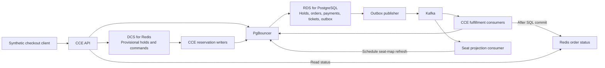

# Flash-sale ticketing on Huawei Cloud

**Qualified at 200 end-to-end journeys per second on Huawei Cloud.** On November 5, 2026, release `1.0.0-rc.26` dispatched **60,000 synthetic checkout journeys in 300 seconds**, and all eventually reached fulfillment with zero drops, customer errors, or retries. Within those 300 seconds, **59,746 tickets** were issued. End-to-end journey p95 was **1.686 seconds**.

[Read the Huawei Cloud case study](CASE_STUDY.md) for the qualification result and local Docker walkthrough.

## Customer problem

Flash sales concentrate requests on a small inventory. A reliable checkout must protect seat ownership, handle repeated payment callbacks, and recover safely after a failed rollout. The qualification used synthetic events, test accounts, and simulated payments.

## Huawei Cloud architecture

The qualified application ran on Huawei Cloud Container Engine (CCE). Huawei Cloud RDS for PostgreSQL held authoritative commerce state. Huawei Cloud DCS for Redis supported provisional reservation intake and cached reads. PgBouncer bounded database connections. Kafka delivered committed work to separate fulfillment and seat projection consumers.



- **Hold.** Redis accepts a provisional reservation. A writer commits the hold and order in PostgreSQL before marking the command durable. The client waits for durability before starting payment.
- **Pay and fulfill.** A signed simulated callback commits the booking or refund decision. An outbox publishes committed events to Kafka. Inbox deduplication and ticket uniqueness protect fulfillment during replay.
- **Recover.** Stop new admission and preserve accepted work. Follow the [rollback checklist](#rollback-checklist) to restore service and reconcile the data.

## Qualification summary

| Check | Recorded result |
| --- | --- |
| Offered and dispatched load | 200 journeys/s for 300 seconds, 60,000 scheduled and 60,000 dispatched |
| Final fulfillment | All 60,000 dispatched journeys fulfilled |
| Drops, customer errors, and retries | 0 |
| End-to-end journey p95 | 1.686 seconds |
| Tickets issued in the 300-second window | 59,746, above the 59,400 floor |
| Tickets issued in the guarded 296-second window | 59,258, above the 59,200 floor |
| Independent financial and relationship audits, hold expiry, queue drain, and restoration | Passed |

The qualification used simulated payments, a pinned Linux/amd64 image, and 19 CCE pods, including four API pods, four reservation writers, six fulfillment consumers, and one seat projection consumer. The capacity result applies to that release, topology, and five-minute workload.

## Rollback checklist

1. **Record the baseline before cutover.** Capture the previous image digests, role settings, replica counts, ingress routes, and consumer-group configuration. Confirm the previous deployment can be restored. Record baseline service health, queue state, and financial state.
2. **Stop admission on a failed gate.** Stop the candidate traffic source and new admissions. Preserve accepted orders and their evidence. Fence candidate writers before resuming the previous writers. Account for accepted orders, payments, tickets, and pending messages.
3. **Restore and reconcile.** Restore the previous ingress, role images, settings, and replica counts. Verify that the original roles are healthy and candidate processes and database sessions are gone. Reconcile holds and expiry, callbacks and queues, payments, bookings, and tickets. Check for duplicate bookings or tickets. Retain durable rows, consumer offsets, and migration history.
4. **Reopen only after verification.** Keep admission closed if a health, reconciliation, or restoration check fails. Resume traffic once the restored deployment passes those checks.

## Run the synthetic demo locally

Use Docker Engine with Compose and free loopback ports 8000, 5432, 6379, and 9090. The local demo uses the default PostgreSQL reservation flow and development-only credentials. It demonstrates checkout behavior. The 200 journeys/s result comes from the separate CCE qualification summarized above.

```sh
docker compose -p huawei-ticketing-case-study up -d --build --wait
docker compose -p huawei-ticketing-case-study run --rm seed
docker compose -p huawei-ticketing-case-study exec api python -m ticketing.cli token --subject demo-buyer
```

1. Open [Swagger UI](http://localhost:8000/docs) and authorize with the demo token.
2. Send `POST /v1/holds` with `Idempotency-Key: demo-hold-1` and `{"event_id":"00000000-0000-0000-0000-000000000001","seat_ids":["A001"]}`. Save the returned `order_id`.
3. Send `POST /v1/orders/{order_id}/payments` with a new idempotency key and `{"outcome":"SUCCEEDED","delay_seconds":1,"duplicates":3}`. The simulator delivers repeated callbacks.
4. Poll `GET /v1/orders/{order_id}` until the order is `FULFILLED` with one ticket.

With the seeded stack running, `docker compose -p huawei-ticketing-case-study run --rm --build tests` runs the included tests. Stop the local stack with `docker compose -p huawei-ticketing-case-study down`. Compose retains the demo volumes.

## Source provenance

The application, migrations, and dependency files are from the qualified `1.0.0-rc.26` source at commit `69438fe`. The snapshot's Dockerfile packages the source and selected tests for the local demo. The cloud qualification used its own pinned image.

## License

This project is licensed under the [MIT License](LICENSE).
