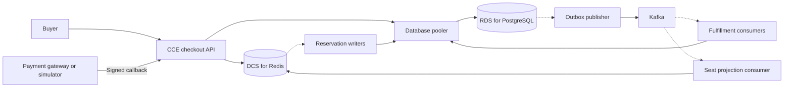

# Flash-sale ticketing implementation guide

**MIT-licensed reference implementation · November 2026**

This guide is for engineering teams building a reserved-seat checkout. It uses a synthetic ticketing application on Huawei Cloud to show how to preserve seat ownership, recover from ambiguous payment outcomes, and issue tickets safely when events are redelivered. The source and documentation are available under the [MIT License](../LICENSE).

## 1. What we verified

| Reference result | Offered workload | Issuance and customer outcomes |
| --- | --- | --- |
| **Current qualification · November 5, 2026 · `1.0.0-rc.26`** | **200 checkout journeys/s for 300 seconds** on Huawei Cloud CCE. All 60,000 scheduled journeys were dispatched and eventually fulfilled. | **59,746 tickets** in the 300-second window and **59,258** in the guarded 296-second window. End-to-end p95 was **1.686 s**. Zero drops, checkout errors, or retries. Financial and relationship audits, hold expiry, queue drain, and restoration passed. |
| **Historical comparison · October 15, 2026** | **140 checkout journeys/s for 300 seconds**. All 42,000 scheduled journeys were dispatched and eventually fulfilled. | 41,827 paid-and-issued tickets in the offered window and 41,547 in the guarded window, or **138.49 tickets/s** over 300 seconds using the guarded count. Worst-shard journey p95 was **2.566 s**. Zero drops, initial checkout errors, or final failures. |
| **Historical failed attempt · October 15, 2026** | **160 checkout journeys/s offered for 300 seconds**. 47,875 of 48,000 scheduled journeys were dispatched and fulfilled. | 125 journeys never started and 16 initial payment errors recovered. The run failed its arrival and initial-error gates. |

Each result applies to its own workload, release, and topology. Both successful runs used simulated payments. The historical latency is a worst-shard statistic, so it should stay labeled separately from the later journey p95. For planning, distinguish the rate at which the generator schedules journeys, the number that eventually finish, and the count of valid tickets issued before the cutoff. Agree the production workload and service objectives separately. [Qualification summary](../README.md#qualification-summary) · [Lessons learned](../CASE_STUDY.md#what-i-learned-building-a-200-journeyss-ticketing-system)

## 2. Agree responsibilities before building

| Owner | First deliverable |
| --- | --- |
| Solution architect | System of record, service boundaries, pilot scope, sizing assumptions, recovery objectives, and cost limits. |
| Developer lead | Seat and payment state model, API and message contracts, migration compatibility, and recovery behavior. |
| QA engineer | Synthetic fixtures, replay and failure scenarios, complete journey accounting, and an independent financial audit. |
| Cloud engineer | Private connectivity, TLS and secret references, pinned release inputs, observability, and a rehearsed restoration plan. |
| Business owner | Sale and expiry rules, customer promises, payment and refund policy, and release approval. |

Start with one isolated event and one authoritative booking path. Agree the sale window, hold lifetime, seats per order, expected arrival shape, gateway behavior, and the definition of a completed journey. Record architecture decisions before implementation, including the alternatives, invariants, failure behavior, and evidence needed for acceptance.

## 3. Architecture and service boundaries

- **CCE** runs the API and workers as separate roles. This lets the team measure and scale reservation persistence, ticket issuance, and seat-map work independently while accounting for the database connections they share.
- **DCS for Redis** supports fast seat availability and optional provisional intake. One Lua operation checks the requested seats, records a provisional hold and its expiry, and appends a reservation command. Event-specific keys keep each show's inventory and stream separate.
- **RDS for PostgreSQL** is the authority for durable holds, bookings, payments, refunds, and tickets. Transactions bind related changes together. A unique `(event_id, seat_id)` booking constraint provides the final seat-ownership guarantee.
- **Kafka** delivers committed work to independent fulfillment and projection consumers. Delivery can repeat. The transactional outbox protects publication, and the inbox and ticket uniqueness constraints protect business effects during replay.

## 4. Follow the checkout across transaction boundaries

1. **Reserve.** Authenticate the buyer and validate the request and idempotency key. The default PostgreSQL path returns a hold after the database commit. The Redis-first path returns `202 PENDING` with stable identities and the original expiry.
2. **Confirm durability.** In Redis-first mode, a writer revalidates and commits the hold, order, items, command receipt, and outbox record in PostgreSQL. It marks the command `DURABLE` and acknowledges the stream entry after commit. The buyer checks the original command until it reaches a terminal state. Payment starts only once the hold is durable.
3. **Initiate payment.** Persist a stable payment operation, release the database connection, then contact the gateway. If a response is lost, look up the original operation before replaying it with the same identity.
4. **Apply the callback.** Authenticate the callback and check its payment identity, amount, currency, and hold state. Commit the financial outcome, booking, and `OrderPaid` outbox event together. If a successful payment arrives after the seat has been reassigned, preserve the new owner's seat and create a durable refund or review obligation.
5. **Publish and fulfill.** The publisher records delivery after Kafka acknowledges the event. The consumer commits its inbox receipt, ticket, and order state before advancing the offset. The buyer retrieves the existing tickets when the order reaches `FULFILLED`.

The qualified profile applied financial effects before acknowledging the callback. An asynchronous callback design would require a durable receipt before acknowledgement and its own qualification. A live gateway integration needs verified initiation, inquiry, settlement, and refund behavior. The reference used a simulator for this boundary.

## 5. Preserve the invariants when adapting the design

| Concern | Implementation rule | Failure case to prove |
| --- | --- | --- |
| Seat ownership | Reserve all selected seats or none. Lock seat rows in a consistent order and use database time to check expiry after locking. Release a provisional hold only if its token still owns the seat. | Two buyers contest one seat. An expired holder's delayed release cannot clear the next hold. |
| Idempotency | Scope keys to the authenticated actor and operation. Compare normalized payloads and replay the original identities and deadline. | Replay the same request after a lost response. Reject the same key with a changed payload. |
| Payment recovery | Inquire about the original operation on the primary. Show a processing state while the outcome is unknown. Retry eligible transient errors within the original deadline. | Lose a response after commit. Deliver a duplicate callback, then a late callback after expiry. |
| Publication and issuance | Commit business state and outbox together. Commit the inbox receipt and ticket together. | Interrupt the publisher after broker ACK or the consumer after SQL commit. Replay produces one ticket per booking. |
| Cached status | Publish snapshots after commit, check ownership on every read, and keep a bounded fallback to the primary. | Expired, out-of-order, or wrong-owner snapshots never become authoritative. |

## 6. Prepare a reproducible cloud release

The `rc.26` qualification used four API processes, four reservation writers, six fulfillment consumers, one seat projection consumer, and one process each for publishing, maintenance, reconciliation, and simulation. Small reservation and fulfillment batches, a short-lived committed order-status cache, and explicit connection limits were part of that tested configuration. Treat those settings as a reference for the measured run. Size each new environment from its own workload and dependency budgets.

1. Establish a private network path for the API, workers, Redis, pooler, RDS, and broker. Verify TLS identity, callback authentication, broker addresses, and least-privilege service credentials.
2. Record the source revision, dependency lock, SWR manifest digest, migrations, per-role commands, resource limits, and resolved non-secret configuration. Verify the running image and settings against that record.
3. Budget database connections across APIs, workers, poolers, observability, administrators, and rolling-update overlap. Include headroom for transaction log growth, storage, and recovery.
4. Check migrations and old/new application compatibility. Record the previous deployment, ingress, worker identities, consumer groups, and queue and financial baseline before changing traffic.
5. Verify readiness and rehearse recovery on a synthetic cohort. For production, agree on acceptable data loss and recovery time, then drill Redis primary loss, broker outages, database recovery, and safe replay.

## 7. Qualify capacity and diagnose the limiting stage

Report scheduled, dispatched, eventually fulfilled, and in-window issued counts separately. Count valid issued tickets by joining payment, order, booking, and ticket identities. Capture first-attempt errors, retries, recovery, and final failures. Publish the latency measurement method, window and drain time, generator drops, and the financial audit result.

| Symptom | First evidence to collect |
| --- | --- |
| Scheduled work never reaches the API | Generator dispatch lag, in-flight occupancy, CPU, and scheduler capacity. |
| Provisional holds wait to become durable | Reservation stream age, writer batch fill, database connection time, and commit and lock waits. |
| Payment requests slow down | Payment and general pool occupancy, transaction duration, locks, and WAL or I/O waits. |
| Paid orders wait for tickets | Outbox age, publication and broker ACK time, consumer lag, and committed issuance counts. |
| Seat maps become stale | Projection lag, Redis command time, cache freshness, and progress for each active event. |

Compare one change at a time on the same release inputs, workload shape, and resource budget. Separate a hot-event opening from traffic spread across screenings. At higher rates, qualify the generator independently before interpreting application capacity. Keep failed results even when recovery and reconciliation succeed.

## 8. Roll out in stages and rehearse rollback

| Stage | Exit evidence |
| --- | --- |
| Correctness pilot | Atomic holds, one durable booking authority, stable payment identities, and safe replay on a synthetic event. |
| Operational rehearsal | Exact runtime identity, healthy dependencies, bounded queues, and verified restoration. |
| Capacity qualification | Complete dispatch, agreed latency and in-window issuance, independent financial audit, and drained work. Short-window, sustained, and hot-opening tests each have their own acceptance scope. |
| Production handoff | Real gateway and settlement checks, named owners, agreed service and recovery targets, retention and cost controls, and a tested rollback. |

On a failed gate, stop new admission and preserve the accepted cohort. Drain or explicitly hand off pending work. Fence the candidate writers before restoring the previous deployment, then verify health, seat ownership, payment and refund obligations, ticket uniqueness, hold expiry, and queue state. Keep admission closed if reconciliation is incomplete. Retain financial records, deduplication history, and recovery evidence.

## 9. Run the local reference demo

Use this reference snapshot with Docker and Compose. The walkthrough seeds synthetic inventory, reserves a seat, simulates payment, and retrieves the issued ticket. A fresh-clone rehearsal verified that three simulated callback deliveries produced exactly one persisted ticket. The demo shows the checkout behavior, while the 200/s evidence comes from the separately qualified CCE run. [Docker walkthrough](../README.md#run-the-synthetic-demo-locally)
